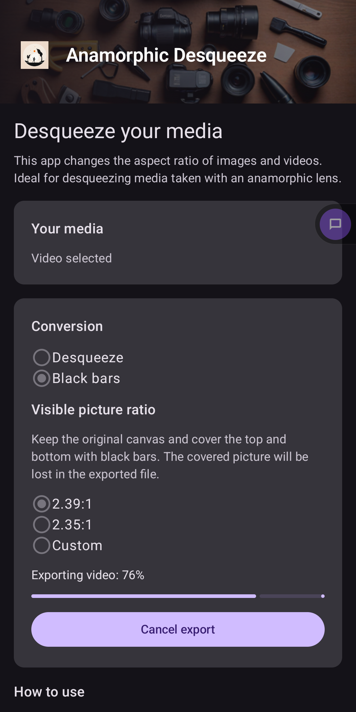

# Anamorphic Desqueeze App

Simple open source Android app to change the aspect ratio of images and videos.

Google Play Store: https://play.google.com/store/apps/details?id=be.hcpl.android.photofilters

Download: [Debug APK v2.0](releases/app-debug-2.0.apk) (debug-signed, separate from the Play Store app).

Project: https://github.com/hanscappelle/anamorphic-desqueeze-android-app.git

## Screenshot

## How to Use

- Tap **Choose image or video** and select media, or share an image or video from your gallery to this app.
- Choose desqueeze or black bars, select the desired ratio, and start the export.
- Find the result in your preferred gallery app.

## Desqueeze

Choose an image or short video from within the app, or share one from your preferred Android gallery. The app creates newly desqueezed media in your gallery.

For images, the width of the original is multiplied by the selected ratio. Videos are re-encoded with the same horizontal scaling while retaining their audio. Video exports are MP4 files; their duration affects export time, battery use, and storage requirements.

## Letterbox

Alternatively, black-bars mode keeps the original canvas and picture proportions, covering the top and bottom to produce a 2.39:1, 1.85:1, 1.90:1, 1.66:1, 1.33:1, or custom visible picture ratio. Covered content is lost in the export. The target ratio must be at least as wide as the source.

## Common Widescreen & Theatrical Ratios

• 2.39:1 (Anamorphic / Scope): Often referred to around 2.35:1, 2.40:1, or 21:9. Widely used for blockbusters, action, and sweeping landscapes, producing prominent black bars on standard 16:9 TVs.
• 1.85:1 (Flat Widescreen): A common Hollywood standard for dramas, comedies, and narrative features, resulting in thin black bars on a 16:9 screen.
• 1.90:1 (Digital IMAX): Used for many large-format and IMAX releases, filling slightly more vertical space than 16:9.

Other Notable Ratios

• 1.66:1: Historically tied to European and independent cinema, offering a balance between widescreen and classic framing.
• 1.33:1: A classic 4:3 picture ratio associated with early films and television.

## Features

- Open an image from your preferred image gallery using Android's share intent
- Open a video from a compatible app using Android's share intent
- Choose an image or video using the system photo picker
- Desqueeze to preferred aspect ratio of width*ratio x height
- Add black bars to images or videos for a cinematic visible picture ratio
- Fixed JPEG full original size 85% compression
- Export desqueezed videos as MP4 with audio preserved, progress, and cancellation
- Opens result in Gallery

## Version History

### 2.0

- support for video
- added image pick option from app
- layout improvements
- project linked in app
- letterbox mode added

### 1.0 

- simplify app versioning
- General UI improvements
- add scrolling to layout for smaller screens
- update header in landscape

### 0.4.0

- show error on problematic image received
- layout improvements
- remember last ratio selection
- remember last custom ratio input

### 0.3.0

- selectable aspect ratio, 1.33x or 1.55x
- allow for fully custom aspect ratio
- technical improvements (app signing update)

### 0.2.0

- Update app icon and app store listing

### 0.1.0

- First version, minimal app release

## Release Info

- use original release key (package re-used)
- create an app bundle (converted using play signing)
- create tag on each release

## Resources

About sharing image intent on Android: 
https://developer.android.com/training/sharing/receive

Display image in compose, including from uri:
https://developer.android.com/develop/ui/compose/graphics/images/loading
https://stackoverflow.com/questions/77226214/jetpack-compose-load-uri-image-on-screen

About permissions to write to storage:
https://developer.android.com/training/data-storage/shared/media

App logo created with:
https://hotpot.ai/logo-generator/create

App Feature Image created with:
https://hotpot.ai/templates/google-play-feature-graphic
