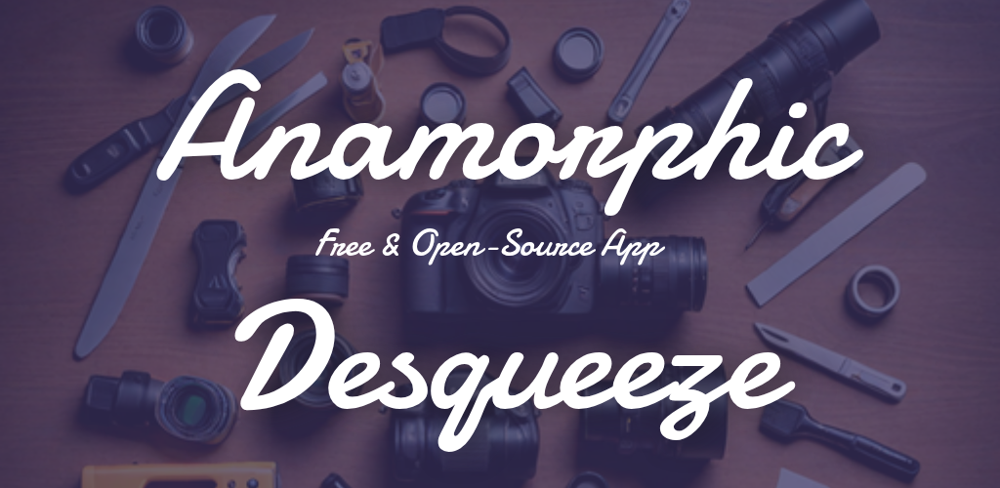

# Anamorphic Desqueeze App

Simple open source Android app to change the aspect ratio of images and videos.

Choose an image or short video from within the app, or share one from your preferred Android gallery. The app creates newly desqueezed media in your gallery.

For images, the width of the original is multiplied by the selected ratio. Videos are re-encoded with the same horizontal scaling while retaining their audio. Video exports are MP4 files; their duration affects export time, battery use, and storage requirements.

Google Play Store: https://play.google.com/store/apps/details?id=be.hcpl.android.photofilters

Project: https://github.com/hanscappelle/anamorphic-desqueeze-android-app.git

## How to Use

To use this app:

- Tap **Choose image or video** and select media, or share an image or video from your gallery to this app.
- Select the desired ratio and start the desqueeze/export.
- Find the result in your preferred gallery app.

## Features

Currently very basic implementation

- Open an image from your preferred image gallery using Android's share intent
- Open a video from a compatible app using Android's share intent
- Choose an image or video using the system photo picker
- Desqueeze to preferred aspect ratio of width*ratio x height
- Fixed JPEG full original size 85% compression
- Export desqueezed videos as MP4 with audio preserved, progress, and cancellation
- Opens result in Gallery

## Version History

### Bugs & Upcoming features

- Configuration for export format (and compression ratio in case of JPEG)

### 2.0

- support for video
- added image pick option from app

### 1.0 

- simplify app versioning
- General UI improvements
- add scrolling to layout for smaller screens
- update header in landscape

### 0.4.0

- show error on problematic image received
- layout improvements
- remember last ratio selection
- remember last custom ratio input

### 0.3.0

- selectable aspect ratio, 1.33x or 1.55x
- allow for fully custom aspect ratio
- technical improvements (app signing update)

### 0.2.0

- Update app icon and app store listing

### 0.1.0

- First version, minimal app release

## Release Info

- use original release key (package re-used)
- create an app bundle (converted using play signing)
- create tag on each release

## Resources

About sharing image intent on Android: 
https://developer.android.com/training/sharing/receive

Display image in compose, including from uri:
https://developer.android.com/develop/ui/compose/graphics/images/loading
https://stackoverflow.com/questions/77226214/jetpack-compose-load-uri-image-on-screen

About permissions to write to storage:
https://developer.android.com/training/data-storage/shared/media

App logo created with:
https://hotpot.ai/logo-generator/create

App Feature Image created with:
https://hotpot.ai/templates/google-play-feature-graphic
